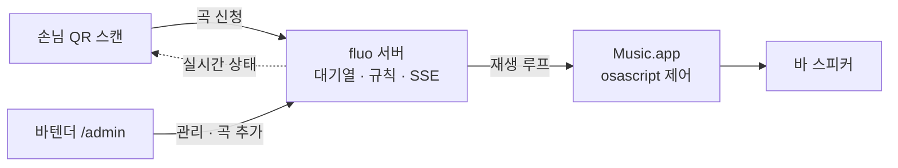

<div align="center">
  
  <h1>🎵 바 주크박스</h1>
  <p><b>손님은 QR로 신청하고, 바의 Mac에서 Apple Music으로 틀어주는 주크박스</b></p>
  <p>
    
    
    
    
  </p>
</div>

---

## ✨ 한눈에 보기

| | 무엇을 하나요 |
|---|---|
| 📱 **손님 화면** (`/?t=<테이블>&k=<시크릿>`) | 테이블 QR 스캔 → 곡 검색·신청 → 하단 미니플레이어에서 재생 상태 확인 → 시트에서 대기열 확인·본인 곡 취소 |
| 🎛️ **바텐더 화면** (`/admin/songs` · `/admin/qr`) | 재생/대기열(드래그 순서 변경) 관리, 곡 추가, 테이블 & QR 생성·인쇄, 신청 일시중지·공지·곡 수 제한 설정 |
| 🎧 **재생 루프** | `osascript`로 Music.app을 제어해 **요청 곡 하나만** 순서대로 재생 |
| ⚡ **실시간** | SSE(`/api/events`)로 재생 상태·대기열 변경을 손님 화면에 즉시 반영 (폴링 폴백 내장) |
| 💾 **영속화** | 큐·히스토리·재생중·설정·테이블을 SQLite에 저장 — 서버를 재시작해도 이어짐 |

## 🎧 동작 흐름



1. 손님이 테이블 QR을 스캔하면 서버가 발급한 기기 쿠키(`bj_did`)로 신원을 확인해요.
2. 신청은 대기열에 **요청 곡 1곡**만 들어가고, 규칙(중복·곡 수 제한)을 통과한 곡만 쌓여요.
3. 재생 루프가 대기열에서 다음 곡을 꺼내 Music.app으로 재생하고, 곡이 끝나면 다음 곡으로 넘어가요.

> **재생 방식에 대하여** — Music.app은 `music://` 앨범 주소로 열면 앨범 전체가 재생 대기열에 들어가지만,
> 뮤트 상태에서 목표 트랙까지 스킵한 뒤 `play once`로 요청 곡 1곡만 남기도록 처리해요.
> 재생 위치는 1초 간격으로 SSE에 실시간 반영돼요.

## 📐 신청 규칙

| 규칙 | 기본값 | 설명 |
|---|---|---|
| 기기(1인)당 곡 수 | **1곡** | 재생중 + 대기 합산. 도달하면 신청 버튼이 잠겨요 |
| 테이블당 곡 수 | **5곡** | 같은 테이블의 모든 기기를 합산해 세요 |
| 중복 트랙 | 차단 | 이미 재생중/대기 중인 같은 곡은 다시 신청할 수 없어요 |
| 본인 곡 취소 | 허용 | 손님이 자기 기기의 대기 곡을 직접 취소할 수 있어요 |
| 바텐더 곡 추가 | 무제한 | `/admin`의 곡 추가는 제한을 건너뛰어요 |

두 제한은 어드민 **운영 설정**에서 언제든 바꿀 수 있어요. `0`을 넣으면 무제한이에요.

## ⚠️ Music.app 자동 재생 끄기 (꼭 한 번!)

> Music.app → 설정 → 재생에서 **자동 재생(비슷한 노래 이어 재생)을 꺼주세요.**
> 켜져 있으면 요청 곡이 끝난 뒤 추천 곡이 대기열에 이어서 쌓입니다.
> 이 설정은 AppleScript로 바꿀 수 없어 수동으로 꺼야 해요.

꺼두지 않아도 추천 곡이 스피커로 나오지 않게 서버가 막지만, 대기열이 깔끔해지려면 꺼두는 게 좋아요.

## 🚀 시작하기

바의 Mac에서 (Apple Music 구독 계정으로 Music.app 로그인 상태):

```bash
git clone https://github.com/ayden94/bar-jukebox.git
cd bar-jukebox
bun install
cp .env.example .env      # ADMIN_TOKEN을 긴 랜덤 문자열로 변경!
bun run build             # 클라이언트 + 서버 빌드
bun start
```

- 🎛️ 바텐더: `http://localhost:5173/admin` (노래 관리 `/admin/songs` · QR 관리 `/admin/qr`) — 비밀번호는 `.env`의 `ADMIN_TOKEN`
- 📱 손님: 어드민에서 만든 테이블 QR 스캔 (같은 Wi-Fi)
- 🧪 격리 API 플로우 점검: `bun run build && bun test-flow.ts`

## ⚙️ .env

```bash
ADMIN_TOKEN=긴-랜덤-문자열
PORT=5173
# 기기 쿠키 서명 키 (미설정 시 ADMIN_TOKEN 사용)
# DEVICE_COOKIE_SECRET=별도의-긴-랜덤-문자열

# QR에 인쇄될 공개 주소 (미설정 시 LAN IP 자동 감지)
# BASE_URL=http://barjukebox.local:5173
```

> **QR은 한 번 인쇄하면 유지**돼요. 서버 주소가 바뀌면 재인쇄가 필요하니 `BASE_URL`로
> 고정 호스트명(mDNS 등)을 쓰는 걸 권장해요.

기기 쿠키는 서명을 검증하고, 공개 상태에는 기기 ID 대신 `isMine`만 내려줘요.
기존 미서명 쿠키는 새 기기로 교체되므로 업데이트 전에 남은 손님 신청을 비우거나
직원이 관리해주세요. 서명 키를 바꾸면 기존 기기 쿠키도 무효가 돼요.
곡 신청과 직원 추가는 `trackId`만 받고 서버가 iTunes에서 재생 정보를 조회해요.
큐·재생중·완료 전환과 설정은 DB 저장에 성공한 뒤 화면에 반영해요.

## 🗂 프로젝트 구조

```
src/
├── main.ts             # 서버 부팅: SQLite 복원 → 앱 기동 → 재생 루프
├── app.tsx             # 라우터·컨트롤러·미들웨어·React 페이지 연결
├── domains/            # queue / table / settings / search / playback / events / admin
│                       #   controller → service → repository (도메인 규칙은 service에)
├── infra/              # drizzle-orm/libsql 클라이언트 + 스키마
├── middleware/         # 기기 식별 쿠키 (bj_did)
└── pages/              # 손님·관리자 React UI (SSR + hydration)
```

## ✅ 검증

```bash
bun test               # 단위 테스트 (큐 규칙 · 저장소 round-trip · 재생)
bun run typecheck      # TypeScript strict
bun run check          # Biome lint + format
bun run build && bun test-flow.ts # 임시 DB·임시 서버·고정 검색 데이터로 HTTP 회귀 검증
bun run dev            # 개발 서버 (fluo dev)
bun run dev:client     # 별도 터미널에서 클라이언트/CSS 빌드 감시
```

플로우 검증은 운영 토큰이나 실행 중인 서버를 사용하지 않고, 실패하면 비정상 종료해요.
실제 Music.app은 실행하지 않아요. 별도 수동 검증 서버가 필요하면
`DATABASE_URL=:memory: PLAYBACK_DISABLED=1`로 실행할 수 있어요.
운영에서는 `PLAYBACK_DISABLED`를 설정하지 마세요.

### React 구성과 이동 검증

`@fluojs/react 0.3.0`의 `ReactNavigationPage`와 공식 initial-page decoder를
사용해 SSR과 hydration, 내부 이동을 연결해요. `/admin/songs`와 `/admin/qr`는
서버 라우트와 페이지 컴포넌트를 따로 유지하고, 내부 이동에서는 공통 문서와
`AdminSession`을 유지해요. 페이지별 검색 입력과 QR 펼침 상태는 이동 시 초기화돼요.
SSE와 폴링은 문서당 브라우저 스토어 하나가 소유하며 `pagehide`에서 닫고
`pageshow`에서 구독자가 있을 때 한 번만 다시 연결해요.

현재 Bun 어댑터는 공식 Node starter의 단일 `fluo dev` Fast Refresh/CSS HMR
지원 대상이 아니에요. 기존 두 개발 명령을 유지하고 Babel 7을 사용해요.
배포할 때는 클라이언트와 서버를 함께 빌드하고 재시작해요.
이미 열린 탭의 빌드가 달라지면 기본 문서 이동으로 새 버전을 불러와요.

브라우저 검증은 임시 DB·임의 포트·임시 토큰으로 재생 비활성화 서버를 직접
시작하고 종료 시 정리해요. 별도 실행 중인 서버나 운영 계정을 사용하지 않아요.
실제 SSE 전송 단절·네트워크 복구와 외부 문서 왕복을 검증해요.
운영의 `no-store` 응답에서는 일반 재로딩 복구를 확인하고, 테스트 프록시가
HTML 캐시 헤더만 바꾼 별도 시나리오에서는 실제 `pageshow.persisted=true`와
같은 문서의 SSE 재연결을 확인해요. 운영 캐시 정책은 바꾸지 않아요.

```bash
bun run build
bun test-flow.ts                      # IPC 준비 신호로 실제 포트를 받아요.
bun tests/react-navigation.browser.ts # Bun 1.4+, 설치된 Chrome 필요
```

### 저장 데이터 검사와 백업

서버는 대기열·최근 재생·현재 재생 곡의 JSON 구조와 숫자 범위를 검사해요.
손상된 행을 조용히 제외하지 않고 테이블·행 식별자와 오류 종류를 표시하며
시작을 중단해요. 원본 데이터는 삭제하지 않으므로 먼저 백업한 뒤 복구해주세요.
현재 Apple 곡 형식을 유지하며 provider ID 전환과 스키마 버전 마이그레이션은
아직 포함하지 않아요.

```bash
# URL이 아닌 파일 경로를 전달해요. 출력 부모 폴더는 미리 만들어주세요.
bun scripts/backup-database.ts ./jukebox.sqlite ./backups/jukebox-2026-10-15.sqlite
```

백업은 SQLite의 `VACUUM INTO`로 WAL의 커밋된 데이터까지 일관된 스냅샷으로
저장해요. 실행 중인 DB에도 사용할 수 있고, 기존 출력 파일은 덮어쓰지 않아요.
백업 파일에는 테이블 시크릿과 신청 소유권 정보가 있으므로 생성 시의
소유자 전용 권한(`0600`)을 유지해주세요.

복원할 때는 DB를 사용하는 서버·도구를 모두 종료한 뒤 기존 DB와 같은 이름의
`-wal`·`-shm` 파일을 함께 다른 위치에 보관해요. 완료된 백업 파일만 설정된
DB 경로에 배치하고, 그 경로에 예전 sidecar 파일이 남지 않았는지 확인한 뒤
서버를 시작해주세요. 실행 중인 원본 DB 파일만 복사하는 방식은 사용하지 않아요.

## 📚 문서

| 문서 | 내용 |
|---|---|
| [`docs/plan-local.md`](docs/plan-local.md) | 로컬 트랙 설계 |
| [`docs/plan-migration.md`](docs/plan-migration.md) | fluo/React 마이그레이션 계획 |
| [`docs/plan-cloud.md`](docs/plan-cloud.md) | 클라우드 SaaS 트랙 (재생은 항상 현장 기기) |
